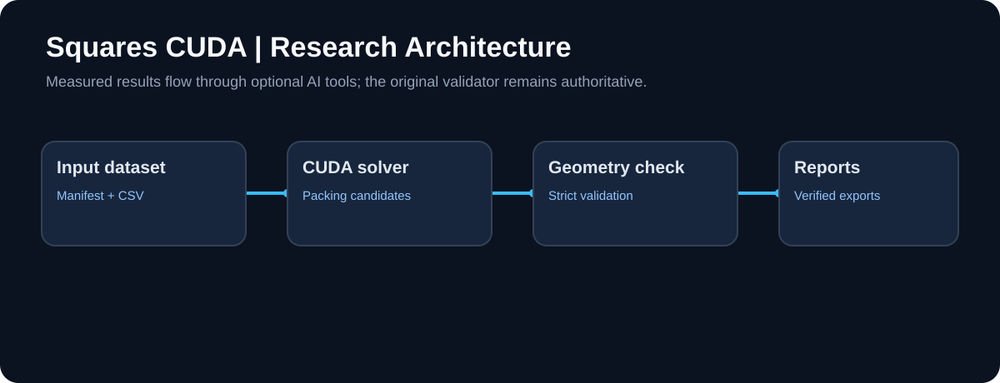
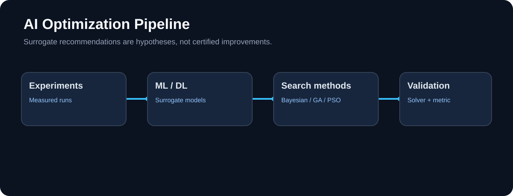
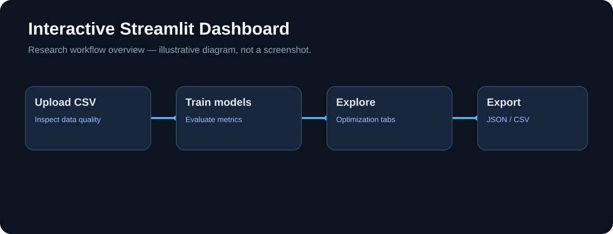

# Squares in Squares — CUDA Packing Research

**Author:** Harpreet Singh

A research notebook for the *squares-in-squares* packing problem, plus an optional AI-analysis toolkit and Streamlit dashboard built around it.

- **Notebook** — CUDA contact restarts, packing-geometry visualisation, frozen baseline replay, strict candidate admission and independent serialized-CSV validation.
- **`packing_ai` toolkit** — surrogate models, Bayesian / evolutionary search, active-learning queue, drift checks and monitoring over *your own measured experiments*.
- **Dashboard** — a Streamlit front end for the toolkit.

> **Scope:** the AI tools never change the original CUDA search, the frozen metric or the validator. Every suggestion they produce is a prediction and stays **UNVERIFIED** until the original solver and the independent geometry/CSV validator confirm it. No score or speed-up improvement is claimed by this repository.

## Visual overview



*Architecture: input data, original CUDA solver, independent geometric validation, verified reports.*



*AI workflow: measured experiments train optional surrogate models; suggested candidates must be verified by the solver and the official metric.*



*Illustration of the dashboard workflow (not an actual screenshot): upload, analyze, optimize, export.*

## Quick start

### A. Run the notebook (replay mode)

1. Use Python 3.10+ and install: `pip install -r requirements.txt`
2. Put the **original input dataset** into `inputs/` (or attach it as a Kaggle dataset). Required files:
   `contact_manifest.json`, `contact_summary.json`, `contact_gpu_report.json`, `contact_v12.csv`, `contact_public_baseline.csv`, `contact_submission.csv`
3. Open `squares_cuda_professional.ipynb` in Jupyter or Kaggle and run the cells top to bottom. The preflight cell reports what is missing; the original setup deliberately stops if a file is missing or a SHA-256 hash differs.
4. Keep `RECOMPUTE_SEARCH=False` to replay. Set it to `True` only if CUDA, CuPy and a suitable GPU are available.
5. Read `validation.json`, `roundtrip_validation.json`, `submission.csv` and `artifacts/professional_reports/` after a successful run.

### B. Run the AI dashboard

```bash
pip install -r requirements-v7.txt -r requirements-dev.txt
streamlit run dashboard/app.py
```

Upload a CSV of **real measured runs** with the columns:

```
n_squares,rotation_fraction,density,restart_budget,step_scale,objective
```

`inputs/experiment_schema.csv` is an empty header-only template, not data. At least **8** rows are needed to load a file and at least **12** clean rows for the bootstrap, bandit and monitoring tools.

### C. Command line

```bash
python -m packing_ai.cli analyze --csv inputs/your_measured_data.csv --out reports/run1
```

### D. Docker (dashboard only)

```bash
docker build -t squares-dashboard .
docker run -p 8501:8501 squares-dashboard
```

No GPU pass-through is configured. Do not expose the dashboard publicly without adding authentication.

### E. Tests

```bash
pip install -r requirements-dev.txt
python -m pytest -q
```

Tests are CPU-only and do not need the proprietary input dataset.

## What the toolkit contains

| Module | Purpose |
| --- | --- |
| `packing_ai/experiments.py` | Load and validate measured CSVs, observed bounds, Random Forest / Gradient Boosting surrogate, optional PyTorch MLP, Optuna TPE suggestions, GPU GEMM benchmark |
| `packing_ai/advanced.py` | Data-quality checks, 5-fold cross-validation, Pareto front, reproducibility manifest, export bundle |
| `packing_ai/v4.py` | Genetic algorithm and particle-swarm search on the surrogate, permutation feature importance, GPU memory profile, local JSON / optional MLflow tracking |
| `packing_ai/v5.py` | Offline ensemble-exploration candidate (bandit-*inspired*), optional SHAP, Optuna study with optional MLflow, CUDA device inventory |
| `packing_ai/v6.py` | Bootstrap-ensemble candidate shortlist, dataset audit, drift report, SQLite candidate registry with provenance |
| `packing_ai/v7.py` | Reproducible epsilon-greedy region proposals over measured data, CPU matmul benchmark, JSON monitoring summary |
| `packing_ai/cli.py` | `analyze` command (data quality + manifest + export) |
| `dashboard/app.py` | Streamlit UI covering all of the above |

## Repository layout

```
squares_cuda_professional.ipynb   original research + quality/reporting sections
requirements.txt                  notebook dependencies (CPU)
requirements-ml.txt               + scikit-learn, Optuna, Streamlit
requirements-v4.txt … -v7.txt     chained extension requirements (optional extras are commented inside)
requirements-dev.txt              + pytest
packing_ai/                       AI research modules
dashboard/app.py                  Streamlit dashboard
inputs/README.md                  what the input dataset must contain
inputs/experiment_schema.csv      empty CSV schema for measured experiments
docs/images/                      SVG diagrams used in this README
tests/                            unit, regression and notebook-structure tests
Dockerfile, .dockerignore         dashboard container
.github/workflows/ci.yml          CPU unit tests on Python 3.10 / 3.11 / 3.12
artifacts/                        created at runtime (git-ignored)
```

Commit the `docs/images/` folder, otherwise the diagrams above appear broken on GitHub. Never commit the original dataset: `inputs/` is git-ignored except for the two template files.

## Integrity and provenance

The notebook keeps the original code cells, the frozen metric checksum, input SHA-256 verification, the official validator and the candidate admission process. The additional reports do not alter the optimizer. Historical scores are **not independently verified by packaging this project**; replay needs the separately supplied input dataset. Do not replace the original metric with a new implementation.

## Reproducibility notes

- CUDA results can differ across drivers, GPU hardware and run time.
- CuPy is optional and not installed by default.
- The notebook may install a pinned `mpmath` version for official-metric compatibility; use a disposable virtual environment.
- PyTorch, SHAP and MLflow are optional. Install a PyTorch build that matches your hardware from <https://pytorch.org/get-started/locally/>.

## Limitations

- Surrogate, Bayesian, evolutionary and bandit tools search a **model of your measured data**, not the packing geometry. They can overfit small datasets.
- The default hold-out is a random split and may leak repeated configurations; for publication use grouped hold-outs, independent seeds and uncertainty estimates. Ensemble spread is a heuristic, not a calibrated confidence interval.
- The "bandit" tools are offline heuristics over recorded data, not a trained or interactive reinforcement-learning agent. RL is intentionally not implemented because no validated environment or reward exists.
- GPU benchmarks time synthetic matrix multiplication, not the original packing kernel. The V7 benchmark is CPU-only. Multi-GPU execution is not implemented.
- The SQLite registry is local and single-instance; the dashboard has no authentication.

## Credits

Project author: Harpreet Singh. Retain all original notebook source attributions, including the Kirill Tymchishin Seam LP V5 work linked in the notebook, and the other credited authors listed in its *Sources and limits* section. This edition adds infrastructure, reporting and tooling, not a claim of an improved optimization score.
